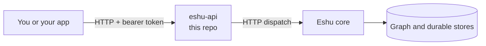

# eshu-api

Status: pre-release. You can build and run this service today.
It is not yet the service that carries live production traffic.

`eshu-api` is the HTTP front door for Eshu. It checks who you are,
routes your request, and passes it to the Eshu core.

## What this is and why it exists

Eshu stores facts about code and cloud systems in a graph.
A graph is a map of things and how they connect.
You read that map over HTTP (the protocol web browsers use).

This repo owns only the HTTP layer. That means:

- Routing: matching a URL path to a handler.
- Auth: checking your bearer token (a secret sent in a header).
- Version handling for `/api/v0/` and `/api/v1/` paths.
- The request and response shapes under `contracts/`.

The Eshu core keeps the durable data. It owns the graph,
the queues, and the database tables. This service never
opens a database table or a queue directly. It only talks
to the core over HTTP.

Splitting the front door from the core lets each part
release on its own. It also keeps secrets and storage
handles out of the public HTTP surface.

## How it fits together



Text version: you send an HTTP request to `eshu-api`.
It checks your token. It then forwards the request to
the Eshu core. The core reads or writes its stores and
replies. `eshu-api` returns that reply to you.

## When to use it, and when not to

Use this repo when you:

- Run the Eshu HTTP API as its own process or container.
- Work on routing, auth, or version headers.
- Check the HTTP shapes under `contracts/` and `openapi/`.

Do not use this repo when you:

- Need to change how facts are stored. That lives in the core.
- Want a command-line tool. Use `eshu-cli` instead.
- Want tools for an AI assistant. Use `eshu-mcp` instead.
- Want one command that runs the whole stack. See
  [eshu-deploy](https://github.com/eshu-hq/eshu-deploy).

## Quickstart

You need Go. Use the version in `go.mod` (Go 1.26.10).
You also need a running Eshu core to dispatch to.

Build and run:

```bash
go build -o /tmp/eshu-api ./cmd/eshu-api
ESHU_API_KEY='change-me' /tmp/eshu-api \
  --core-base-url http://localhost:8443
```

`--core-base-url` is required. The service will not start
without it. Replace the URL with your core address.

Check that it works. Health needs no token:

```bash
curl -s http://localhost:8080/health
curl -s http://localhost:8080/readyz
```

A healthy reply looks like this (shortened). The real
`/health` body lists one version key per contract family:

```json
{"status":"ok","service":"eshu-api","core_read_contracts":"v0","core":"http://localhost:8443"}
{"service":"eshu-api","probe":"readyz","status":"ok"}
```

Now call the API with your token:

```bash
curl -s -H "Authorization: Bearer $ESHU_API_KEY" \
  http://localhost:8080/api/v0/openapi.json | head -c 200
```

Without a token, `/api/*` returns `401`. That is expected.

## How it works

Requests in:

- `GET /health`, `GET /readyz`, and `GET /metrics` are public.
  This service answers them itself.
- `/api/*` needs a valid bearer token. A missing or wrong
  token gets a `401` reply.
- `/api/v1/*` is rewritten to `/api/v0/*` before dispatch.
- `/api/v0/*` replies carry `Deprecation` and `Sunset`
  headers. `/api/v1/*` replies do not.

Responses out:

- Most `/api/*` calls are forwarded to the core as-is.
  Status, headers, and body come back byte for byte.
  Redirects from the core are not followed.
- Some write families are handled here first, then written
  through a versioned core contract. See `contracts/`.
- If the core cannot be reached, you get a local
  `503 backend_unavailable` with no `Retry-After` header.
- `GET /api/v0/openapi.json` serves the API description.
  It needs a token, like the rest of `/api/*`.

Your token crosses to the core only in the
`Authorization` header. It is never logged.

## Configuration

| Name | Required | Default | Meaning |
| --- | --- | --- | --- |
| `--addr` | No | `:8080` | Address and port to listen on. |
| `--core-base-url` | Yes | none | Core read-API origin, for example `https://core:8443`. Startup fails if empty. |
| `ESHU_API_KEY` (env) | Yes, in practice | empty | Shared bearer token checked on `/api/*`. Env only, never a flag. If empty, every `/api/*` call gets `401`. |
| `ESHU_API_V0_SUNSET_DATE` (env) | No | `Thu, 01 Jul 2027 00:00:00 GMT` | Date sent in the `Sunset` header on `/api/v0/*`. Must be an RFC 1123 date, or the default is used. |

There is no flag for the API key. That is on purpose.
Flags show up in process lists. Env values do not.

## Deploy and run

The `Dockerfile` builds a small image. It compiles the
binary with Go 1.26.10, then copies it onto a distroless
base with no shell. The image exposes port `8080` and
starts `/eshu-api` as its entrypoint.

```bash
docker build -t eshu-api:dev .
docker run --rm -p 8080:8080 -e ESHU_API_KEY='change-me' \
  eshu-api:dev --core-base-url http://host.docker.internal:8443
```

You can also run the binary directly, as in Quickstart.
Releases publish `ghcr.io/eshu-hq/eshu-api`. See
[release notes](docs/release.md) for tags and checks.

For a full-stack deploy (core plus every service), use
[eshu-deploy](https://github.com/eshu-hq/eshu-deploy).
This repo alone does not deploy the core.

## Eshu dependencies

|  | What |
| --- | --- |
| Needs | A reachable Eshu core at `--core-base-url`. A shared key in `ESHU_API_KEY` that callers also send. |
| Talks to | The core over HTTP only, using the versioned contracts in `contracts/`. |
| Never touches | Core database tables, queues, or lease state. It holds no storage handles and imports no core storage code. |

## Operations

Health checks:

- `GET /health` — `200` with service name and contract
  versions. Use it to confirm the process is up.
- `GET /readyz` — `200` with `{"service":"eshu-api","probe":"readyz","status":"ok"}`.
- `GET /metrics` — Prometheus text (a common metrics
  format) with per-family request and dispatch counts.
  See [telemetry](docs/telemetry.md).

Logs are JSON lines on stdout. Each dispatch logs one
`api request` line with method, family, status, and a
correlation ID (an ID that ties one request together).

Common startup failures:

- `eshu-api: --core-base-url is required` — you did not
  pass the flag. The process exits with code `1`.
- The service starts but every `/api/*` call is `401` —
  `ESHU_API_KEY` is unset, or callers send a different key.
- `/api/*` returns `503 backend_unavailable` — the core
  URL is wrong or the core is down. Check `--core-base-url`.

## Development

Run the same checks as CI:

```bash
make ci       # parity, lint, test, race
make lint     # vet, golangci-lint, format, 500-line file cap
make test     # go build ./... and go test ./...
make race     # race tests plus the coverage floor
make parity   # bash scripts/check-parity.sh
```

You need `golangci-lint` v2.12.2 and `git` for `make lint`.
Go files must stay at or under 500 lines.

## Docs and related repos

- [What this build serves](docs/skeleton.md) — scope and limits.
- [Telemetry](docs/telemetry.md) — metrics and log fields.
- [Compatibility notes](docs/parity.md) — what moved, what stayed.
- [Provenance](docs/provenance.md) — source pins and file map.
- [Release](docs/release.md) — how images are published.
- [Core read contracts](contracts/core-read-contracts.md)

Related: `eshu` (core), `eshu-cli` (command line),
`eshu-mcp` (AI-assistant tools), and
[eshu-deploy](https://github.com/eshu-hq/eshu-deploy)
(full-stack deploys).

## Contributing, security, and license

See [CONTRIBUTING.md](CONTRIBUTING.md) for CI lanes and
local checks. This repo has no `SECURITY.md` and no
`LICENSE` file. Source files carry an
`SPDX-License-Identifier: MIT` header. Report security
issues privately to the maintainers, not in a public issue.
