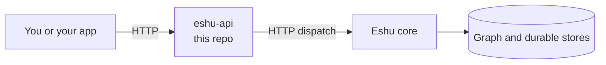

# eshu-api

Status: pre-release. You can build and run it today, but it isn't the
service carrying live production traffic yet.

`eshu-api` is Eshu's HTTP front door. It checks who's calling, works out
where the request goes, and hands it to the Eshu core. The core keeps the
graph (a map of things and how they connect) and all the durable data.
This repo owns only the HTTP layer: routing, auth, `/api/v0/` and
`/api/v1/` handling, and the request and response shapes under
`contracts/`. It never opens a database table or queue itself. Everything
crosses to the core over HTTP, which is what lets the two parts release
on their own schedule.



In words: you send a request here first. We check it, pass it to the
core, and hand the core's reply back to you.

## Is this the repo you want?

Reach for it when you run the HTTP API as its own process, or when you're
working on routing, auth, version headers, or the shapes in `contracts/`
and `openapi/`.

Skip it when you need to change how facts get stored (that's the core),
when you want a terminal tool (use `eshu-cli`), when you want tools for
an AI assistant (use `eshu-mcp`), or when you want one command that runs
the whole stack (see
[eshu-deploy](https://github.com/eshu-hq/eshu-deploy)).

## Quickstart

You'll need Go 1.26.10 (see `go.mod`) and a running core to point at.

```bash
go build -o /tmp/eshu-api ./cmd/eshu-api
ESHU_API_KEY='change-me' /tmp/eshu-api --core-base-url http://localhost:8443
curl -s http://localhost:8080/health
curl -s http://localhost:8080/readyz
```

`--core-base-url` is required, so swap in your own core address. If
things are up, `/readyz` answers `{"service":"eshu-api","probe":"readyz","status":"ok"}`
and `/health` lists the contract versions this build serves. Both probes
work without a token. Most `/api/*` calls need your Bearer token, though
a handful of setup, login, and docs routes stay public by design. The
full list lives in [Configuration](docs/reference/configuration.md).

## Documentation

| Guide | What you will find |
| --- | --- |
| [Documentation index](docs/README.md) | The map of every page below |
| [Getting started](docs/getting-started/README.md) | Fastest run and first answered call |
| [Guides](docs/guides/README.md) | Operate, auth setup, and troubleshooting, step by step |
| [Concepts](docs/concepts/README.md) | Boundaries and the story of one request |
| [Configuration reference](docs/reference/configuration.md) | Every flag and env var, plus how auth actually behaves |
| [Architecture](docs/architecture/README.md) | Place in Eshu, components, and stack |
| [Diagrams](docs/diagrams/README.md) | Every diagram, with captions and text versions |
| [What this build serves](docs/skeleton.md) | Scope and limits of the current build |
| [Telemetry](docs/telemetry.md) | Metrics on `/metrics` and the fields in each log line |
| [Release](docs/release.md) | Tags, images, and how to check a published digest |
| [Core read contracts](contracts/core-read-contracts.md) | The versioned read contracts dispatch relies on |
| Maintainer history: [parity](docs/parity.md), [provenance](docs/provenance.md), and the `*-latency.md` notes in `docs/` | What moved where, source pins, and the latency evidence behind each lane |

## Related repos

`eshu` holds the core. `eshu-cli` is the command line, `eshu-mcp` serves
tools to AI assistants, and
[eshu-deploy](https://github.com/eshu-hq/eshu-deploy) runs the full
stack.

## Development

`make ci` runs the same checks as CI (parity, lint, test, race). It needs
`golangci-lint` v2.12.2 and `git`, and Go files stay at or under 500
lines.

## Contributing, security, and license

See [CONTRIBUTING.md](CONTRIBUTING.md) for the local checks. There's no
`SECURITY.md` or `LICENSE` file here; source files carry an
`SPDX-License-Identifier: MIT` header. If you find a security issue,
please tell the maintainers privately rather than opening a public issue.
