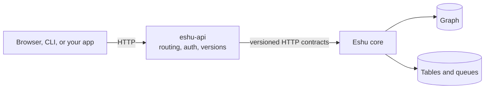
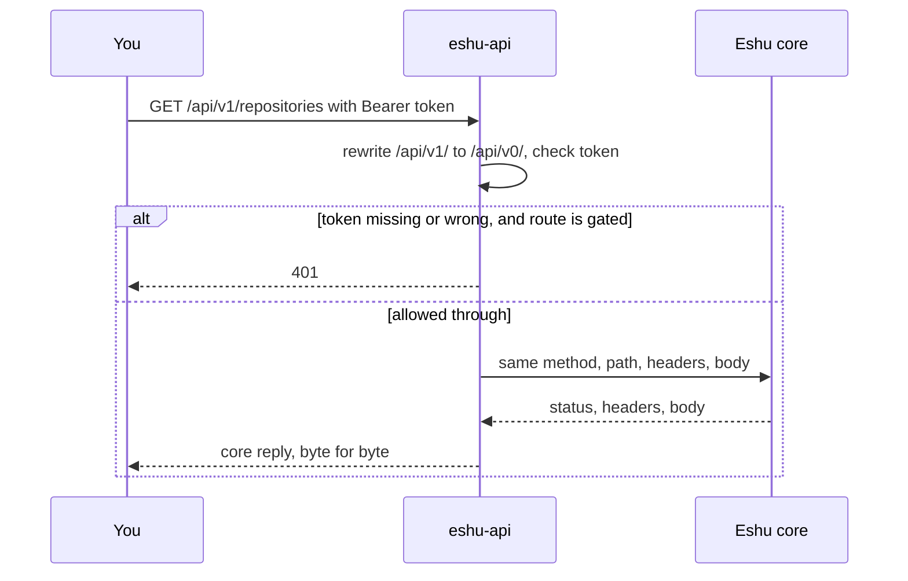

# Diagrams: eshu-api

Every diagram for this repo lives on this page, each with a caption and
a text version so the story survives even where Mermaid doesn't render.
Other pages link here instead of carrying their own copies. The repo
[README](../../README.md) keeps the first one as its single picture.

## Where eshu-api sits

*You, the front door (this repo), and the core with its stores.*

Text version: a caller (browser, CLI, or your app) sends HTTP to
`eshu-api`. `eshu-api` sends versioned HTTP contracts to the Eshu core.
The core alone talks to the graph and to its tables and queues. If the
core moves, you change one flag (`--core-base-url`) and callers notice
nothing.

See also: [Boundaries](../concepts/boundaries.md) and
[Architecture](../architecture/README.md).

## What happens to one request

*Version tidy-up, token check, then we get out of the way.*

Text version:

1. You call `GET /api/v1/repositories` with a Bearer token.
2. We rewrite `/api/v1/` to `/api/v0/` and check the token when the
   route asks for one.
3. Missing or wrong token on a gated route: you get a local `401`.
4. Allowed through: we forward the same method, path, headers, and
   body to the core, and the core's status, headers, and body come
   back to you untouched.
5. If we can't reach the core at all, you instead get a local
   `503 backend_unavailable` with no `Retry-After` header. That missing
   header is deliberate: the failure is on our side of the fence.

See also: [Request story](../concepts/request-story.md).
